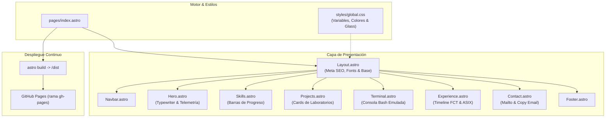

<div align="center">

# 🌐 Portfolio Profesional — Marco Octavio Maciel Borges
### 🛡️ Administrador de Sistemas, Redes y Ciberseguridad Defensiva (ASIX / SMR)
**Barcelona, España**

<p align="center">
  <a href="https://marcooctavio89.github.io/portfolio-Marco-Octavio-Maciel-Borges/"></a>
  
  
  
</p>

[](https://linkedin.com)
[](mailto:marcooctavio89@gmail.com)
[](LICENSE)

<br/>

> **Portfolio web personal interactivo** enfocado en infraestructura TI, seguridad defensiva y administración de sistemas. Diseñado con una estética profesional limpia en **blanco y azul turquesa**, rompiendo con las plantillas oscuras habituales para ofrecer la máxima legibilidad, velocidad y claridad para reclutadores técnicos.

</div>

---

## 🚀 Características Principales

| Módulo | Descripción Técnica |
|---|---|
| **💻 Consola Bash Interactiva** | Emulador de terminal con comandos reales (`help`, `whoami`, `skills`, `projects`, `languages`, `contact`, `status`, `cv`, `clear`), historial con flechas `↑`/`↓` y botones de acceso directo. |
| **📊 Matriz de Especialización** | Competencias estructuradas en 4 pilares (Sistemas & Redes, Ciberseguridad, SIEM & Monitorización, Desarrollo/BD) con medidores de nivel y tags por tecnología. |
| **🛡️ Proyectos Relevantes** | Casos prácticos de laboratorio con snippets de ejecución en consola, aportes de arquitectura y enlaces a repositorios (SSH auth audit, Wireshark, Active Directory y ELK Stack). |
| **📅 Trayectoria & Formación** | Línea de tiempo estructurada con detalle de funciones en soporte IT (Fundació Pere Tarrés) y formación técnica superior (ASIX y SMR). |
| **📬 Canal de Conexión** | Tarjetas de contacto directo, copiado de email en un clic y generador de enlaces `mailto:` con asunto y cuerpo formateados. |
| **⚡ Rendimiento y SEO** | Desarrollado con islas de arquitectura en Astro, metadatos OpenGraph, tipografía legible (*Inter* + *Fira Code*) y 100% responsive. |

---

## 🛠️ Tecnologías Empleadas

- **Framework Web:** [Astro](https://astro.build/) (Static Site Generation ultra rápido y ligero)
- **Estilos:** [Tailwind CSS v4](https://tailwindcss.com/) con paleta personalizada *Clean White & Turquoise*
- **Lenguaje:** TypeScript / JavaScript Vanilla para interactividad cliente
- **Despliegue:** [GitHub Pages](https://pages.github.com/) automatizado mediante rama `gh-pages`

---

## 📐 Arquitectura del Proyecto



---

## 📁 Estructura del Repositorio

```text
portfolio-Marco-Octavio-Maciel-Borges/
├── public/
│   ├── favicon.svg              # Icono del portfolio
│   ├── Marco_Maciel_CV.pdf      # Currículum descargable
│   └── marco_foto.jpg           # Fotografía de perfil
├── src/
│   ├── components/
│   │   ├── Navbar.astro         # Barra de navegación responsive
│   │   ├── Hero.astro           # Cabecera principal y typewriter
│   │   ├── Skills.astro         # Matriz de habilidades técnicas
│   │   ├── Projects.astro       # Casos prácticos y laboratorios
│   │   ├── Terminal.astro       # Consola interactiva emulada
│   │   ├── Experience.astro     # Trayectoria y formación
│   │   ├── Contact.astro        # Formulario y canales de contacto
│   │   └── Footer.astro         # Pie de página
│   ├── layouts/
│   │   └── Layout.astro         # Layout base y configuración SEO
│   ├── pages/
│   │   └── index.astro          # Página principal
│   └── styles/
│       └── global.css           # Estilos globales y paleta turquesa
├── astro.config.mjs             # Configuración de Astro
├── package.json                 # Dependencias y scripts
└── README.md                    # Documentación del proyecto
```

---

## 💻 Instalación y Ejecución Local

Si deseas clonar y ejecutar este portfolio en tu entorno local:

1. **Clonar el repositorio:**
   ```bash
   git clone https://github.com/marcooctavio89/portfolio-Marco-Octavio-Maciel-Borges.git
   cd portfolio-Marco-Octavio-Maciel-Borges
   ```

2. **Instalar dependencias:**
   ```bash
   npm install
   ```

3. **Iniciar el servidor de desarrollo:**
   ```bash
   npm run dev
   ```
   Abre [http://localhost:4321](http://localhost:4321) en tu navegador.

4. **Compilar para producción:**
   ```bash
   npm run build
   ```

5. **Desplegar a GitHub Pages:**
   ```bash
   npm run deploy
   ```

---

## 👨‍💻 Autor

**Marco Octavio Maciel Borges**  
Técnico en Sistemas Microinformáticos y Redes (SMR) | Especialización en ASIX  
📍 Barcelona, España  
- **GitHub:** [@marcooctavio89](https://github.com/marcooctavio89)  
- **Email:** [marcooctavio89@gmail.com](mailto:marcooctavio89@gmail.com)  
- **Web en Vivo:** [marcooctavio89.github.io/portfolio-Marco-Octavio-Maciel-Borges](https://marcooctavio89.github.io/portfolio-Marco-Octavio-Maciel-Borges/)
